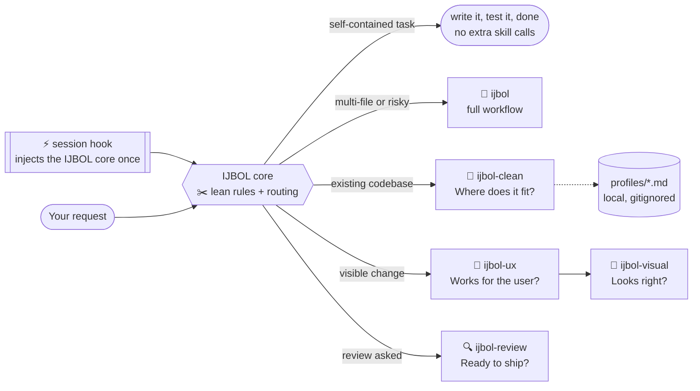
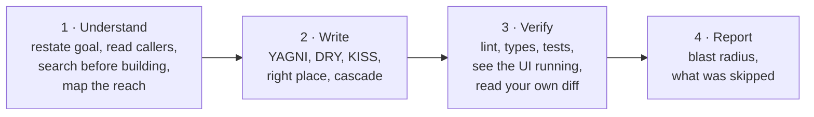
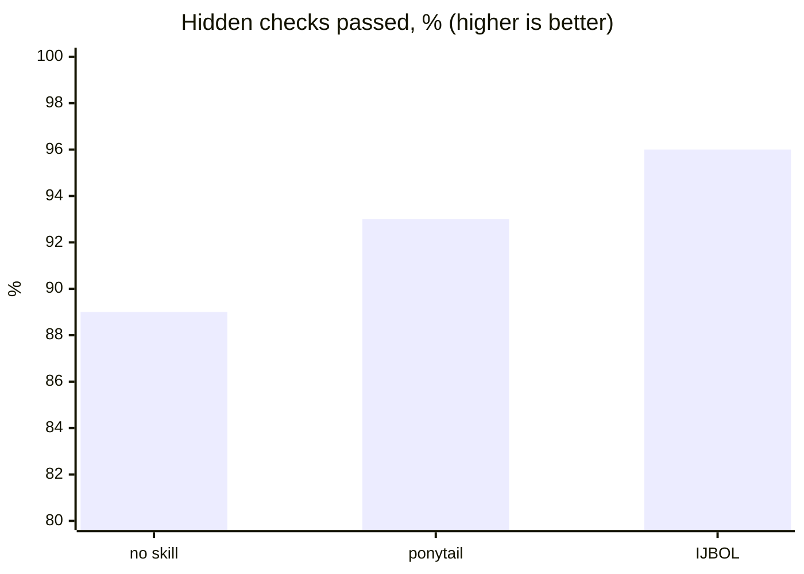
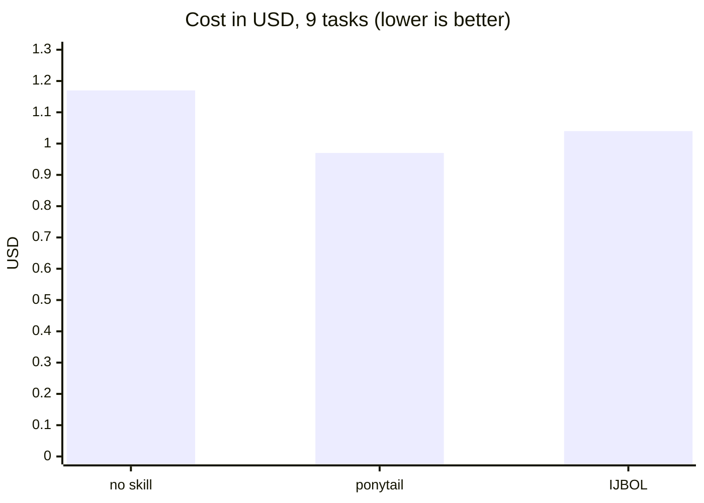

<p align="center">
  
</p>

<p align="center">
  <a href="#install"></a>
  
  <a href="#benchmark"></a>
  <a href="#built-on-ponytail"></a>
</p>

**IJBOL: It Just Builds, Obviously Lean.** The diff is so small you burst
out laughing.

This is a Claude Code skill pack for lean, clean, good-looking code. One
conductor (`ijbol`) loads the right specialist for the job. Each specialist
answers one question, and each rule is written down in only one skill.

## The skills

| | Skill | Answers | Use it directly when |
|---|---|---|---|
| 🎼 | `ijbol` | What's the workflow? Understand → write → verify → report | Any code change (load it first) |
| ✂️ | `ijbol-lean` | How small? YAGNI, smallest complete change | "be lazy", "simplest", over-engineering |
| 🧹 | `ijbol-clean` | Where and how does it fit? Placement, components, types, naming, no regression, security, project profiles | Refactors, "make it clean", conventions |
| 🧭 | `ijbol-ux` | Does it work for the user? UX lens, states, accessibility, design chain | UI reviews, any visible change |
| 🎨 | `ijbol-visual` | Does it look right? Hierarchy, spacing, type, color, depth | "looks off", polish, design systems |
| 🔍 | `ijbol-review` | Is it ready to ship? Must / Should / Nice findings plus a verdict | "review this", staged changes, PRs |

## How they fit together



The core rules ([`hooks/core.md`](hooks/core.md), about 430 words) are
always on. The specialists load only when a task needs them, so a small task
costs no extra tool calls.

Every change goes through the same four steps:



## Install

**As a plugin (recommended).** Its session hook turns IJBOL on for every
session automatically. This is the setup the benchmark measures. Skill names
get a prefix, e.g. `/ijbol:ijbol-review`:

```
/plugin marketplace add froilansam/ijbol
/plugin install ijbol@ijbol
```

**As personal skills.** You type the names without a prefix (`/ijbol`,
`/ijbol-review`, and so on), and edits in this repo apply right away. Any
skill with the same name, and any skill with one of the old names, is moved to
`~/.claude/skills-backup-<date>/` first. Nothing is deleted.

```
git clone https://github.com/froilansam/ijbol && cd ijbol && ./install.sh
```

Personal skills get no session hook. To turn the core on anyway, import it
into `~/.claude/CLAUDE.md` with one line (use your clone's path):

```
@~/ijbol/hooks/core.md
```

Use one install method or the other. If you install both, every skill loads
twice.

## Project profiles

The skills are generic. Conventions for one codebase go in a profile:
`skills/ijbol-clean/profiles/<repo>.md`. It is gitignored, so private or
company rules never get pushed. Start the file with which repo it applies to,
then add whatever that codebase needs: file structure, naming table, UI kit,
state library, test/lint commands, gotchas. `ijbol-clean` reads the matching
profile before editing, and its rules beat the generic ones.

## Benchmark

Each cell below is a real headless Claude Code session on Opus 5.5: 9 tasks,
scored by hidden correctness and safety checks. It runs on
[ponytail's harness](#built-on-ponytail), with ponytail and IJBOL run side by
side, 3 runs each. The full method, per-task numbers and limits are in
[benchmarks/](benchmarks/README.md).

| vs no skill | source LOC | output tokens | total tokens | cost | time | pass |
|---|--:|--:|--:|--:|--:|--:|
| no skill | | | | | | 89% |
| ponytail | **−67%** | **−42%** | −1% | **−17%** | **−37%** | 93% |
| **IJBOL** | **−62%** | **−39%** | +4% | **−12%** | **−34%** | **96%** |





**The honest read:**

- IJBOL passed more hidden checks than any other arm.
- Compared with no skill, it is cheaper, faster, and writes far less code.
- Ponytail is still a few points leaner on cost and tokens. At this sample
  size, a gap that small is close to noise.
- IJBOL v1 loaded every skill with its own tool call. That doubled the turns
  and cost 24% *more* than no skill. v3 injects the core once through a hook,
  and the [benchmark notes](benchmarks/README.md#how-we-got-here-v1--v3)
  show how the numbers changed.

## Renamed from

| Old | New |
|---|---|
| `ulti` | `ijbol` ("ulti" still triggers it) |
| `ponytail` | `ijbol-lean` |
| `clean-code-implementation` | `ijbol-clean` |
| `ui-ux-frontend-review` | `ijbol-ux` |
| `refactoring-ui` | `ijbol-visual` |
| review mode inside `ulti` | `ijbol-review` |

## Credits

- `ijbol-visual` summarizes tactics from *Refactoring UI* by Adam Wathan and
  Steve Schoger.

## Built on ponytail

IJBOL stands on [**ponytail**](https://github.com/DietrichGebert/ponytail) by
[Dietrich Gebert](https://github.com/DietrichGebert), the "lazy senior dev"
skill: the best code is the code you never wrote.

- `ijbol-lean` is ponytail's skill with only the name and trigger words
  changed (MIT, see [`skills/ijbol-lean/LICENSE`](skills/ijbol-lean/LICENSE)).
- The benchmark above runs on ponytail's
  [agentic benchmark harness](https://github.com/DietrichGebert/ponytail/tree/main/benchmarks/agentic)
  with one extra `ijbol` arm.
- The full ponytail plugin adds things IJBOL does not have: session hooks,
  `ponytail-review`, `ponytail-audit` and `ponytail-debt`. If you only want
  the lean part, install ponytail itself.
